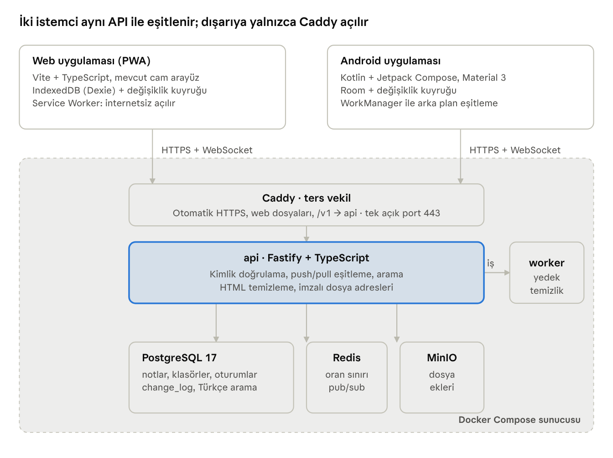

# Cam Notlar

Apple Notes tarzı, buzlu cam (glass) arayüzlü bir not uygulaması. Hedef: Docker ile kendi sunucunda çalışan bir eşitleme sunucusu, çevrimdışı çalışan bir web uygulaması (PWA) ve yerel bir Android uygulaması.



## Depo içeriği

| Yol | İçerik |
| --- | --- |
| [`prototype/index.html`](prototype/index.html) | Çalışan arayüz prototipi: tek HTML dosyası, bağımlılık yok |
| [`docs/PLAN.md`](docs/PLAN.md) | Sunucu, web ve Android için ayrıntılı geliştirme planı |
| `docs/img/` | Mimari diyagramı |

## Prototipi çalıştırma

`prototype/index.html` dosyasını tarayıcıda açman yeterli. Ya da yerel bir sunucuyla:

```bash
cd prototype
python3 -m http.server 8080
# http://localhost:8080
```

Prototipte şunlar var:

- **Masaüstü:** üç cam sütun (klasörler, not listesi, editör), açılıp kapanan kenar çubuğu.
- **Mobil:** iOS tarzı kayan ekranlar, büyük başlıklar, altta biçim araç çubuğu.
- **Notlar:** zengin metin (başlık, kalın, italik, altı/üstü çizili, listeler, kontrol listesi), sabitleme, klasöre taşıma, Son Silinenler, arama.
- **Ayarlar:** Otomatik / Açık / Gece / Zamanlı görünüm, saf siyah gece modu, 6 renk teması, cam yoğunluğu, yazı tipi ve boyutu, sıralama, yedekleme.
- **Kısayollar:** `Alt+N` yeni not, `/` arama, `Ctrl+,` ayarlar.

Notlar ve ayarlar şimdilik yalnızca tarayıcının `localStorage` alanında saklanır. Sunucu eşitlemesi plandaki uygulama sırasının 2. ve 3. adımında gelecek.

## Planlanan yapı

```
apps/api/        Fastify + TypeScript sunucu ve worker
apps/web/        Vite + TypeScript PWA (prototipten taşınacak)
apps/android/    Kotlin + Jetpack Compose
packages/shared/ ortak tipler ve HTML sözleşmesi
deploy/          docker-compose.yml, Caddyfile, .env.example
```

Ayrıntılar, uygulama sırası ve açık kararlar için [docs/PLAN.md](docs/PLAN.md) dosyasına bak.
