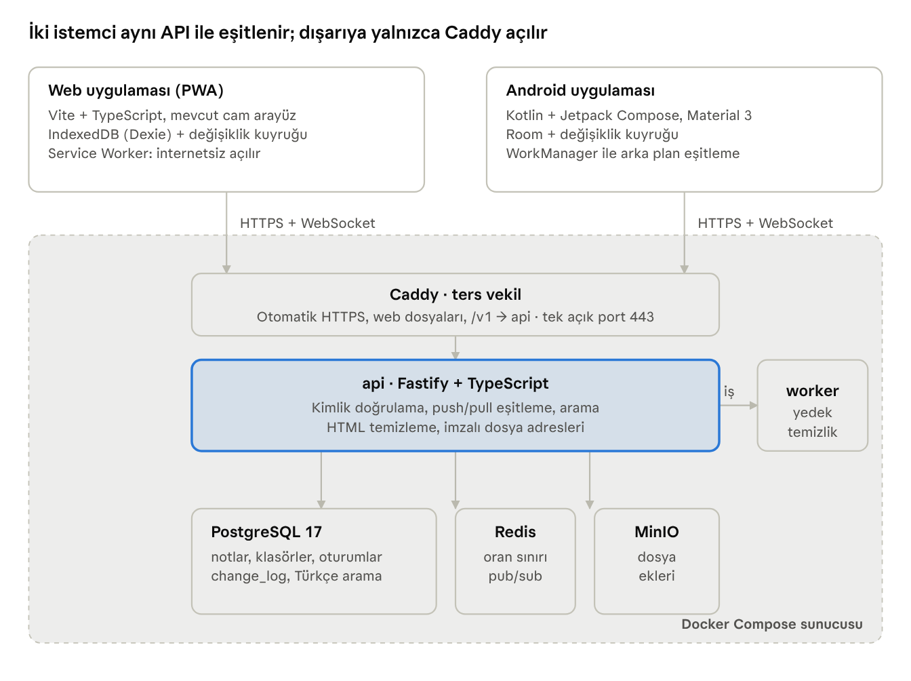

# Cam Notlar — Sunucu, Web ve Android Planı

27 Kasım 2026

## Özet

Cam Notlar; Docker Compose ile tek komutla kurulan bir senkronizasyon sunucusu, çevrimdışı çalışan bir web uygulaması (PWA) ve yerel bir Android uygulamasından oluşacak. Üçü aynı REST API'yi ve aynı senkronizasyon protokolünü kullanır; plan bölüm bölüm sırayla Claude Code ile uygulanır.

**Hedefler**

- Notlar her cihazda çevrimdışı yazılabilir, bağlantı gelince birkaç saniye içinde eşitlenir.
- Sunucu kendi makinende veya bir VPS'te `docker compose up -d` ile ayağa kalkar; veriler senin elinde kalır.
- Mevcut cam arayüz web'de birebir korunur, Android'de aynı görsel dil Material 3 üzerine taşınır.
- Çoklu kullanıcı, oturum yönetimi, dosya ekleri ve otomatik yedekleme v1.0'da hazırdır.

**Ana kararlar**

- Sunucu: Node.js 22 + TypeScript (Fastify), PostgreSQL 17, dosyalar için MinIO, önde Caddy (otomatik HTTPS).
- Web: mevcut tasarım Vite + TypeScript projesine taşınır, veriler IndexedDB'de tutulur, Service Worker ile kurulabilir PWA olur.
- Android: Kotlin + Jetpack Compose, yerel veritabanı Room, arka plan eşitleme WorkManager.
- Senkronizasyon: istemci önce yerel veritabanına yazar, değişiklikleri sırayla sunucuya iter; çakışmada "son yazan kazanır" + çakışma kopyası.

**Kapsam dışı (v1.0):** gerçek zamanlı ortak düzenleme, uçtan uca şifreleme ve iOS uygulaması. Bunlar sonraki sürümlere bırakıldı.

## Mimari genel bakış



Web ve Android istemcileri yalnızca Caddy üzerinden api servisine konuşur; veritabanı, Redis ve MinIO dış dünyaya kapalı iç Docker ağında kalır. Her istemci kendi yerel veritabanıyla tam çalışır, sunucu notların ortak kaynağıdır.

## Teknoloji seçimleri

Tüm katmanlarda tipli diller ve uzun süre desteklenen, Docker'da resmi imajı olan bileşenler seçildi. Sürümler proje başlarken güncel LTS'e sabitlenmeli.

| Katman | Seçim | Neden | Alternatif |
| --- | --- | --- | --- |
| API sunucusu | Node.js 22 LTS + Fastify + TypeScript | Hızlı, şema doğrulaması (JSON Schema/Zod) yerleşik; web istemcisiyle ortak tip paylaşımı | Go (Fiber) — daha az bellek, ama tip paylaşımı yok |
| ORM / göç | Drizzle ORM + drizzle-kit | SQL'e yakın, göç dosyaları okunabilir | Prisma |
| Veritabanı | PostgreSQL 17 | JSONB, tam metin arama (Türkçe sözlük), güvenilir yedekleme | SQLite (tek kullanıcı kurulumları için) |
| Önbellek / kuyruk | Redis 7 (Valkey) | Oran sınırlama, WebSocket yayını (pub/sub), arka plan işleri | Postgres LISTEN/NOTIFY |
| Dosya ekleri | MinIO (S3 uyumlu) | Resim/PDF ekleri; ileride AWS S3'e taşımak kolay | Yerel disk birimi |
| Ters vekil | Caddy 2 | Let's Encrypt ile otomatik HTTPS, tek satır yapılandırma | Traefik, Nginx |
| Web istemcisi | Vite + TypeScript + Preact (veya vanilla) | Mevcut HTML/CSS korunur; küçük paket boyutu | React, SvelteKit |
| Web yerel veri | IndexedDB (Dexie.js) | Çevrimdışı kayıt ve sıralı değişiklik kuyruğu | OPFS + SQLite WASM |
| Android | Kotlin 2 + Jetpack Compose + Material 3 | Yerel performans, `Modifier.blur` ile cam efekti (Android 12+) | Capacitor ile web'i sarmak (daha hızlı, daha az yerel) |
| Android veri / ağ | Room, WorkManager, Retrofit + OkHttp, Hilt | Standart Jetpack yığını, çevrimdışı eşitleme | Ktor client, Koin |
| Zengin metin | HTML alt kümesi (div, h2, b, i, u, s, ul, ol, li.check) | Web editörüyle birebir uyumlu, sunucuda temizlenebilir | Markdown, ProseMirror JSON |

**Not içerik biçimi:** web'deki editörün ürettiği HTML alt kümesi sözleşme olarak sabitlenir. Sunucu her kayıtta izin verilen etiket ve sınıf listesine göre temizler; Android bu alt kümeyi kendi editör modeline çevirir.

## Veri modeli

Tüm kimlikler istemcide üretilen UUIDv7'dir; böylece not çevrimdışıyken oluşturulup sonradan sunucuya aynı kimlikle gönderilebilir. Her eşitlenen tabloda `version` (sunucu sayıcısı), `updated_at` ve silme için `deleted_at` bulunur.

| Tablo | Ana alanlar | Açıklama |
| --- | --- | --- |
| `users` | id, email (benzersiz), password_hash, display_name, created_at | Argon2id ile karma |
| `sessions` | id, user_id, device_id, refresh_hash, expires_at, revoked_at | Her cihaz için ayrı yenileme belirteci |
| `devices` | id, user_id, name, platform (web/android), last_seen_at, push_token | "Oturum açık cihazlar" ekranı için |
| `folders` | id, user_id, name, sort_order, version, updated_at, deleted_at | Mevcut klasör yapısı |
| `notes` | id, user_id, folder_id, html, title, snippet, pinned, created_at, updated_at, trashed_at, deleted_at, version, base_version | `trashed_at` = Son Silinenler, `deleted_at` = kalıcı silme izi |
| `note_revisions` | id, note_id, html, version, device_id, created_at | Son 50 sürüm; geçmiş ve çakışma kurtarma |
| `attachments` | id, note_id, user_id, object_key, mime, size_bytes, sha256, created_at | Dosya MinIO'da, kayıt burada |
| `user_settings` | user_id, data (JSONB), version, updated_at | Tema, gece modu, yazı tipi; cihazlar arası eşitlenir |
| `change_log` | seq (bigserial), user_id, entity, entity_id, version, op, created_at | Eşitleme imleci; istemci "seq X'ten sonrasını" ister |

**İndeksler:** `notes(user_id, updated_at DESC)`, `notes(user_id, folder_id)`, `change_log(user_id, seq)`, arama için `to_tsvector('turkish', title || ' ' || plain_text)` üzerinde GIN indeksi.

**Saklama:** `deleted_at` dolu kayıtlar 90 gün sonra gece çalışan bir işle tamamen silinir; Son Silinenler'deki notlar 30 gün sonra otomatik kalıcı silinir (Apple Notes ile aynı davranış).

## Senkronizasyon ve çevrimdışı çalışma

İstemci her değişikliği önce yerel veritabanına yazar, arayüz hiç sunucuyu beklemez. Eşitleme iki yönlü ve imlece dayalıdır: istemci kendi kuyruğunu **iter** (push), sonra son bildiği `seq`'ten sonrasını **çeker** (pull).

1. **Yerel yazma:** not kaydedilince yerel tabloya yazılır ve `outbox` kuyruğuna `{entity, id, op, base_version, payload}` eklenir. Aynı nota ardışık yazımlar kuyrukta birleştirilir.
2. **Push:** `POST /v1/sync/push` en fazla 100 değişikliği tek seferde gönderir. Sunucu her biri için `base_version` ile mevcut `version`'ı karşılaştırır.
3. **Eşleşiyorsa:** kayıt yazılır, `version + 1` olur, `change_log`'a satır eklenir ve kullanıcının diğer cihazlarına WebSocket üzerinden "değişiklik var" sinyali gider.
4. **Eşleşmiyorsa (çakışma):** sunucu yeni gelen içeriği yine kabul eder (son yazan kazanır), ama üstüne yazılan sürümü aynı klasörde **"Not başlığı (çakışma kopyası — Pixel 8)"** adıyla yeni not olarak saklar. Veri asla kaybolmaz.
5. **Pull:** `GET /v1/sync/pull?since=<seq>` sayfalı olarak değişen kayıtları döner; istemci yerel kopyasını günceller ve yeni `seq`'i saklar.
6. **Tetikleyiciler:** uygulama açılışı, yazmayı bıraktıktan 2 saniye sonra, WebSocket sinyali, ağ geri geldiğinde ve Android'de 15 dakikada bir WorkManager.

**Klasör ve ayarlar** aynı protokolle eşitlenir. Klasör silinirken içindeki notlar Son Silinenler'e taşınır; başka cihazda o klasöre eklenmiş yeni bir not varsa sunucu onu varsayılan "Notlar" klasörüne alır.

**Kontrol listesi işaretleri** HTML içinde `li.done` sınıfı olarak durduğu için ayrıca eşitlenmez; not bütün olarak gider. Gerçek zamanlı ortak düzenleme (v2) gerektiğinde not içeriği Yjs CRDT belgesine geçirilir ve bu protokol yalnızca üst verileri taşır.

## REST API uç noktaları

Tüm uçlar `/v1` altında, JSON konuşur ve OpenAPI 3.1 belgesi koddan otomatik üretilir (`/v1/docs`). Web ve Android istemcileri bu belgeden üretilen tiplerle çalışır.

| Yöntem | Yol | İşlev |
| --- | --- | --- |
| POST | `/v1/auth/register` | Hesap oluştur (sunucuda kayıt açıksa) |
| POST | `/v1/auth/login` | E-posta + parola → erişim ve yenileme belirteci |
| POST | `/v1/auth/refresh` | Yenileme belirtecini döndür, yenisini al |
| POST | `/v1/auth/logout` | Bu cihazın oturumunu kapat |
| GET | `/v1/me` | Profil ve kota bilgisi |
| GET / DELETE | `/v1/devices`, `/v1/devices/:id` | Oturum açık cihazları listele / uzaktan çıkış |
| POST | `/v1/sync/push` | Yerel değişiklik kuyruğunu gönder; her kayıt için `ok` veya `conflict` döner |
| GET | `/v1/sync/pull?since=&limit=` | Bir `seq`'ten sonraki değişiklikler, sayfalı |
| GET | `/v1/notes`, `/v1/notes/:id` | Liste ve tek not (eşitleme dışı erişim, entegrasyonlar için) |
| GET | `/v1/notes/:id/revisions` | Not geçmişi |
| GET | `/v1/search?q=` | Sunucu taraflı tam metin arama |
| POST | `/v1/attachments` | Yükleme için imzalı MinIO adresi al |
| GET | `/v1/attachments/:id` | İmzalı indirme adresi (5 dk geçerli) |
| GET / PUT | `/v1/settings` | Kullanıcı ayarları (tema, gece modu, yazı) |
| GET | `/v1/export` | Tüm verinin JSON + ekler ZIP yedeği |
| WS | `/v1/ws` | "Değişiklik var" sinyalleri |
| GET | `/healthz`, `/readyz` | Docker sağlık kontrolleri |

Hata yanıtları tek biçimdedir: `{"error": {"code": "note_conflict", "message": "..."}}`. Liste uçları imleçli sayfalama (`cursor`) kullanır.

## Kimlik doğrulama ve güvenlik

Kimlik doğrulama kısa ömürlü erişim belirteci + döndürülen yenileme belirteci modeliyle yapılır; parolalar Argon2id ile saklanır ve trafik yalnızca HTTPS üzerinden akar.

- **Belirteçler:** erişim belirteci JWT (EdDSA imzalı, 15 dk). Yenileme belirteci rastgele 256 bit, veritabanında yalnızca karması tutulur, her kullanımda yenilenir; eski belirteç tekrar kullanılırsa o cihazın tüm oturumu iptal edilir.
- **Web'de saklama:** yenileme belirteci `HttpOnly; Secure; SameSite=Strict` çerezde, erişim belirteci yalnızca bellekte. JavaScript yenileme belirtecini hiç görmez.
- **Android'de saklama:** belirteçler Android Keystore ile şifrelenmiş DataStore'da; Room veritabanı SQLCipher ile şifrelenebilir (ayarlarda seçenek).
- **Uygulama kilidi:** Android'de biyometrik kilit (BiometricPrompt), web'de isteğe bağlı PIN ile kilitli notlar (v1.1).
- **Parola kuralları:** en az 10 karakter, sızdırılmış parola listesine karşı kontrol (HIBP k-anonimlik), girişte IP + e-posta başına oran sınırı (Redis, 10 deneme / 15 dk).
- **İçerik güvenliği:** not HTML'i sunucuda izin listesiyle temizlenir (sanitize-html); web'de sıkı Content-Security-Policy, `script-src 'self'`.
- **Kayıt:** `ALLOW_SIGNUP=false` ile kapatılabilir; yönetici CLI ile davet bağlantısı üretir (`docker compose exec api npm run invite -- e-posta`).
- **2FA:** TOTP tabanlı iki adımlı doğrulama v1.1'de.
- **Kapsam dışı ama planlı:** uçtan uca şifreleme (v2). Etkinleştiğinde not içeriği istemcide XChaCha20-Poly1305 ile şifrelenir; sunucu arama yapamaz hale gelir, bu yüzden isteğe bağlı olur.

## Docker sunucu kurulumu

Sunucu tek bir `docker-compose.yml` ile 6 servis olarak çalışır; dışarıya yalnızca Caddy'nin 80/443 portları açılır. En küçük önerilen makine 2 vCPU, 2 GB RAM, 20 GB disk.

| Servis | İmaj | Görev | Kalıcı birim |
| --- | --- | --- | --- |
| `caddy` | `caddy:2-alpine` | HTTPS, web dosyalarını sunar, `/v1` → api | `caddy_data` (sertifikalar) |
| `api` | `ghcr.io/<kullanıcı>/camnotlar-api` | Fastify API + WebSocket | — |
| `worker` | aynı imaj, `node dist/worker.js` | Çöp kutusu temizliği, önizleme, yedek | — |
| `db` | `postgres:17-alpine` | Ana veritabanı | `pg_data` |
| `redis` | `valkey/valkey:8-alpine` | Oran sınırı, pub/sub, iş kuyruğu | — |
| `minio` | `minio/minio` | Dosya ekleri | `minio_data` |

**Dizin yapısı (monorepo):**

```
camnotlar/
  apps/api/        Fastify sunucu + worker
  apps/web/        Vite PWA
  apps/android/    Kotlin/Compose (Gradle)
  packages/shared/ ortak tipler, HTML temizleme kuralları
  deploy/          docker-compose.yml, Caddyfile, .env.example, backup.sh
```

**Ortam değişkenleri (`.env`):** `DOMAIN`, `ACME_EMAIL`, `POSTGRES_PASSWORD`, `JWT_PRIVATE_KEY`, `MINIO_ROOT_USER`, `MINIO_ROOT_PASSWORD`, `ALLOW_SIGNUP`, `MAX_ATTACHMENT_MB` (varsayılan 25), `TRASH_RETENTION_DAYS` (30). Parolalar ilk kurulumda `deploy/init.sh` ile rastgele üretilir.

**Kurulum adımları:**

1. Alan adının A kaydını sunucuya yönlendir.
2. `git clone` → `cd deploy` → `./init.sh` (gizli değerleri üretir, `.env` yazar).
3. `docker compose up -d` — api başlarken veritabanı göçlerini kendisi uygular.
4. `docker compose exec api npm run admin:create` ile ilk yönetici hesabı.
5. `https://DOMAIN` adresinde web uygulaması açılır; Android'de giriş ekranına aynı adres yazılır.

**Yedekleme:** worker her gece 03:00'te `pg_dump` + MinIO yansısı alır, 7 günlük ve 4 haftalık kopya tutar; isteğe bağlı olarak restic ile harici S3/Backblaze'e gönderir. Geri yükleme `deploy/restore.sh <tarih>` ile tek komuttur ve her sürümde test edilir.

**Güncelleme:** `docker compose pull && docker compose up -d`. İmajlar sürüm etiketlidir (`1.0.3`), `latest` kullanılmaz. Yerel ev sunucusu için alan adı yoksa Tailscale veya Cloudflare Tunnel ile erişim belgelenir.

## Web istemcisi (PWA)

Mevcut tek dosyalık uygulama ([`prototype/index.html`](../prototype/index.html)), görünümü değişmeden modüllere bölünür ve localStorage yerine IndexedDB + eşitleme motoruna bağlanır. Kullanıcı için fark: giriş ekranı, eşitleme göstergesi ve cihazlar arası aynı notlar.

**Modüller**

- `ui/` — kenar çubuğu, liste, editör, ayarlar sayfası, iletişim kutuları (mevcut CSS değişkenleri ve temalar aynen taşınır).
- `editor/` — contenteditable, biçim komutları, kontrol listesi, yapıştırmada temizleme. `execCommand` yerine kendi küçük komut katmanı yazılır (tarayıcı desteği kalkınca kırılmaması için).
- `store/` — Dexie tabloları: folders, notes, outbox, meta (`lastSeq`, kullanıcı).
- `sync/` — push/pull döngüsü, WebSocket, üstel geri çekilme ile yeniden deneme, sekmeler arası kilit (BroadcastChannel + Web Locks API) ki iki sekme aynı anda eşitlemesin.
- `api/` — OpenAPI'den üretilmiş istemci, belirteç yenileme ara katmanı.

**Yeni ekranlar ve durumlar**

- Giriş / kayıt / sunucu adresi (kendi sunucusunu kuran için ilk ekranda "Sunucu: notlar.ornek.com").
- Kenar çubuğu altında eşitleme durumu: "Eşitlendi · şimdi", "Çevrimdışı — 3 değişiklik bekliyor", hata.
- Ayarlara yeni bölümler: Hesap, Cihazlar, Not geçmişi, Dışa aktar (sunucu ZIP'i).
- Not geçmişi paneli: sürüm listesi, farkları vurgulama, geri yükleme.
- Ekler: sürükle-bırak, yapıştırma ile resim, küçük resim önizleme.

**PWA**

- `manifest.webmanifest`: ad, simgeler (192/512, maskable), tema rengi aktif temadan.
- Service Worker (Workbox): uygulama kabuğu önbellekte, ilk açılıştan sonra internetsiz açılır; yeni sürümde "Güncelleme hazır" bildirimi.
- Masaüstü ve Android Chrome'da "Uygulamayı yükle"; iOS Safari'de ana ekrana ekle.

**Performans hedefleri:** ilk yükleme < 150 KB (gzip), 5.000 notta liste kaydırma 60 fps (sanal liste), arama yazımı < 50 ms (yerel indeks: MiniSearch).

## Android uygulaması

Uygulama Kotlin + Jetpack Compose ile yerel yazılır; minimum Android 8.0 (API 26), hedef güncel API. Cam efekti Android 12+ cihazlarda gerçek bulanıklık, eski cihazlarda yarı saydam düz yüzey olarak görünür.

**Mimari:** tek Activity, Compose Navigation, MVVM + tek yönlü veri akışı (ViewModel → StateFlow → ekran). Katmanlar: `ui` → `domain` (kullanım durumları) → `data` (Room + Retrofit + SyncEngine). Bağımlılık enjeksiyonu Hilt.

**Modüller (Gradle):** `:app`, `:core:designsystem` (cam yüzeyler, renk temaları, tipografi), `:core:database`, `:core:network`, `:core:sync`, `:feature:folders`, `:feature:notes`, `:feature:editor`, `:feature:settings`, `:feature:auth`.

**Ekranlar**

- Giriş: sunucu adresi + e-posta/parola, QR ile giriş (web'deki Ayarlar → Cihazlar'dan üretilen kod).
- Klasörler, not listesi, editör: web'in mobil düzeniyle birebir aynı akış, sistem geri hareketiyle geri dönüş, öngörülü geri animasyonu.
- Tablette (≥ 840 dp) iki/üç bölmeli düzen: `ListDetailPaneScaffold`.
- Ayarlar: görünüm (Otomatik/Açık/Gece/Zamanlı), 6 tema, saf siyah, yazı tipi/boyutu, biyometrik kilit, eşitleme sıklığı, yalnızca Wi-Fi'de ek indir. Ayarlar sunucuyla eşitlenir.

**Editör:** Compose için zengin metin kütüphanesi (ör. `compose-rich-editor`) HTML alt kümesiyle eşlenir; kontrol listesi öğeleri dokunulabilir daire. Eşleme web ile ortak test vakalarıyla doğrulanır: aynı HTML → Android → HTML dönüşü birebir aynı kalmalı.

**Sistem entegrasyonları**

- Paylaş menüsü: başka uygulamadan metin/resim paylaşınca yeni not.
- Ana ekran widget'ı (Jetpack Glance): sabitlenmiş notlar ve "Yeni not" butonu.
- Hızlı ayarlar kutucuğu ve uygulama kısayolları: Yeni not, Yeni kontrol listesi.
- Bildirim: yalnızca eşitleme hatası kalıcıysa; anlık eşitleme için FCM sessiz itme (isteğe bağlı, kendi sunucusunu kuran FCM anahtarı girmezse WorkManager yeterli).

**Dağıtım:** imzalı APK GitHub Releases'te; Google Play yayını istenirse sonra eklenir; F-Droid için FCM'siz derleme türü (`foss` flavor).

## Test, CI/CD ve izleme

Her çekme isteği GitHub Actions'ta üç uygulamayı da derleyip test eder; `main`'e birleşen her sürüm etiketi Docker imajını, web paketini ve Android APK'yı otomatik üretir.

| Alan | Araç | Ne test edilir |
| --- | --- | --- |
| API birim + entegrasyon | Vitest + Testcontainers (gerçek Postgres) | Kaçırılması en riskli yer: push/pull, çakışma kopyası, yetki sınırları |
| Eşitleme senaryoları | Özel simülatör (2–3 sahte istemci, rastgele çevrimdışı aralıklar) | Sonunda tüm istemciler aynı duruma geliyor mu, veri kayboluyor mu |
| Web | Vitest + Playwright (Chromium, WebKit, mobil görünüm) | Not oluştur/düzenle/sil, çevrimdışı mod, temalar |
| Android | JUnit + Turbine, Compose UI testleri, Roborazzi ekran görüntüsü | ViewModel durumları, editör HTML dönüşümü, açık/gece ekranları |
| Ortak HTML sözleşmesi | `packages/shared/fixtures/*.html` | Web ve Android aynı örneklerle dönüşüm testi |
| Güvenlik | npm audit, Trivy (imaj taraması), OWASP ZAP temel tarama | Bilinen açıklar, başlıklar |

**Boru hattı:** lint → tip kontrolü → testler → derleme → (etikette) `ghcr.io`'ya çoklu mimari imaj (amd64 + arm64, Raspberry Pi için) → web paketi imaja gömülür → Android APK imzalanıp GitHub Releases'e eklenir.

**İzleme:** API yapılandırılmış JSON günlük yazar (pino); `/metrics` Prometheus biçiminde (istek süresi, eşitleme gecikmesi, çakışma sayısı). İsteğe bağlı `docker-compose.monitoring.yml` ile Prometheus + Grafana + Uptime Kuma. İstemci hataları için kendi barındırılan GlitchTip (Sentry uyumlu), varsayılan kapalı.

## Uygulama sırası

Plan tarihe bağlı değil: adımlar aşağıdaki sırayla Claude Code ile uygulanır, her adım kendi otomatik testleri geçince bir sonrakine geçilir. Tüm adımlar bitince uygulamayı sen kendin denersin; ayrı bir beta süreci yok.

1. **Hazırlık:** monorepo iskeleti, CI, OpenAPI taslağı, ortak HTML sözleşmesi ve fixture dosyaları.
2. **Sunucu çekirdeği + Docker:** veri modeli, kimlik doğrulama, push/pull eşitleme ve `docker-compose.yml`. Temiz makinede `docker compose up -d` ile kalkar; API ve eşitleme testleri yeşil.
3. **Web PWA:** prototip Vite projesine taşınır, IndexedDB ve eşitleme bağlanır. Playwright testleri iki sekme + çevrimdışı senaryosunu geçer.
4. **Android uygulaması:** Compose arayüz, Room ve WorkManager ile eşitleme. Editör dönüşüm ve UI testleri geçer, imzalı APK üretilir.
5. **Ekler, not geçmişi, yedekleme, izleme:** iki istemcide resim ekleri, geçmişten geri yükleme ve yedekten geri yükleme betiği test edilmiş.
6. **Senin denemen:** sunucuyu kurup web ve Android'den kullanırsın; bulduğun sorunlar yeni adımlar olarak eklenir.

**Sonraki sürümler:** 2FA ve kilitli notlar, tablet düzeni ve widget iyileştirmeleri, gerçek zamanlı ortak düzenleme ve uçtan uca şifreleme.

## Riskler ve açık kararlar

En büyük teknik risk zengin metnin web ve Android arasında birebir korunması; bu yüzden ortak HTML sözleşmesi ve test örnekleri ilk adımda sabitlenir.

| Risk | Etki | Önlem |
| --- | --- | --- |
| Android editörü HTML'i bozar (çift kontrol listesi, kayıp biçim) | Yüksek | Ortak fixture testleri; desteklenmeyen etiketi silmek yerine olduğu gibi saklamak |
| Çakışma kopyaları kullanıcıyı rahatsız eder | Orta | Aynı cihazdan gelen ardışık yazımlar çakışma sayılmaz; v2'de CRDT |
| `execCommand` tarayıcılardan kaldırılır | Orta | Kendi komut katmanı (Web istemcisi bölümü) |
| Eski Android'de bulanıklık yok / yavaş | Düşük | API 31 altında düz yarı saydam yüzey |
| Ev sunucusunda veri kaybı | Yüksek | Gece yedeği + harici kopya + her sürümde geri yükleme testi |
| Kendi sunucusunu kuranlar güncellemeyi atlar | Orta | API sürüm başlığı; istemci eski sunucuyu tanıyıp uyarı gösterir |

**Karar verilmesi gerekenler**

- [ ] Tek kullanıcı (sadece sen/aile) mı, yoksa açık kayıtlı çok kullanıcılı hizmet mi? Tek kullanıcıysa Redis ve MinIO çıkarılıp kurulum 3 servise iner.
- [ ] Android yerel (Kotlin/Compose) mi, yoksa web'i Capacitor ile sarmak mı? Capacitor Android tarafını çok kısaltır, ama widget, paylaş menüsü ve editör hissi zayıflar.
- [ ] Sunucu nerede çalışacak: evde (Raspberry Pi/NAS) mi, VPS'te mi? Alan adı ve HTTPS yöntemi buna göre seçilir.
- [ ] Uygulama adı "Cam Notlar" kalıyor mu? Play Store kaydı ve paket adı (`com.camnotlar.app`) için erken gerekli.
- [ ] Google Play'de yayınlanacak mı, yoksa yalnızca APK mı? Play için geliştirici hesabı ve gizlilik politikası sayfası gerekir.
